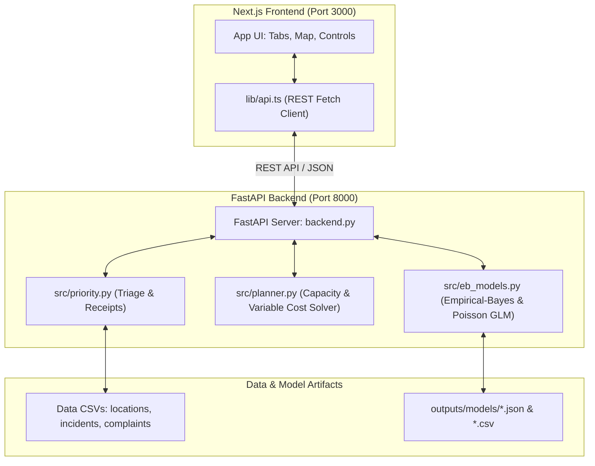

# FixFirst: Civic Operations Triage & Resource Allocation System

> **DATATHON 2026 · Track 3: Smart City — "Where Should We Fix First?"**  
> *A defensible, evidence-grounded decision tool that tells municipal teams which locations to review first, shows transparent score receipts, quantifies rank stability, and converts limited crew and budget capacity into an optimized, variable-cost work plan.*

> [!NOTE]  
> **Synthetic Educational Data Notice:** Coordinates, timestamps, and outcomes are simulated for educational evaluation. They do not represent a real municipality and must not be used for actual public-safety or emergency decisions.

---

## 📌 Executive Summary

Municipal operations teams face a recurring challenge: hundreds of reported incidents and public complaints arrive daily across thousands of urban locations, but public works crews and budget are strictly limited.

FixFirst solves this by answering two operational questions:
1. **Where should we inspect first?** — Ranks 1,000 locations using transparent, current-state facts (open incidents, recent injuries, aging complaints, and human exposure) rather than noisy historical forecasts.
2. **What can our crews actually complete today?** — Solves a multi-constraint resource allocation problem (crews, working days, and budget) where each incident is evaluated with **dynamic variable costs** based on its severity tier, case priority score, injury complexity, and location mobilization.

---

## 🔬 Core Finding: Why Current-State Triage Beats Forecasting

Before building FixFirst, we rigorously tested whether machine learning models could reliably predict future incident locations on this dataset:

- **208 Association Tests**: Tested every outcome against every location attribute, hour, weekday, and month. **Zero (0)** passed the Bonferroni threshold ($p < 2.4 \times 10^{-4}$).
- **9 Gradient-Boosting Probes**: Evaluated under time-based train/test splits (Train: Jan–Aug, Test: Sep–Dec). All probes matched naive majority-class baselines (AUC $\approx 0.50$, $R^2 \approx 0.0$).
- **Poisson Dispersion Test**: Pearson ratio $1.058$ ($p = 0.099$). Location-level incident distributions do not differ significantly from random Poisson noise.
- **Historical Count Trap**: Ranking locations purely by raw past incident counts produces a Poisson deviance of **2.52**, which is substantially worse than a global mean baseline (**1.09**).

**The Architectural Choice**: Instead of offering an unreliable predictive forecast, FixFirst prioritizes based on **active backlog, verified harm, and vulnerable exposure**, while reporting rank stability intervals honestly.

---

## 🚀 Key Features

### 1. Dynamic Variable-Cost Work Planning Engine
- **Incident-Specific Variable Costing**:
  - **Base Severity Tier**: Low (₹3,000, 0.25 crew-days), Medium (₹6,000, 0.50 crew-days), High (₹12,000, 0.75 crew-days), Critical (₹20,000, 1.00 crew-days).
  - **Priority Multiplier**: Scaled from `0.85x` to `1.20x` depending on the case priority score.
  - **Harm Complexity**: Adds `+₹2,000` and `+0.10` crew-days per reported injury.
  - **Mobilization Overhead**: Adds `+₹2,000` and `+0.25` crew-days each time a crew relocates to a new site.
- **Multi-Constraint Optimization**:
  - Dynamically evaluates **crew capacity** ($\text{crews} \times \text{days}$) and **budget limits**.
  - Automatically identifies and displays the active system bottleneck: `Budget`, `Crew capacity`, or `Both`.
- **Dual Schedule Views**:
  - **By Priority**: Sequential dispatch ordered by urgent case priority.
  - **By Crew**: Partitioned itineraries showing each crew's assigned locations, days used, and budget allocation.
- **One-Click Re-Planning**:
  - Computes the exact monetary and crew-day shortfall for the top 10 deferred high-priority cases.
  - One-click button applies the recommended capacity and updates the plan in real-time.

### 2. Multi-Policy Triage Lenses
Municipalities can tailor triage to their policy priorities:
- **Safety-first**: Prioritizes severe incidents, recent injuries, and school/hospital exposure.
- **Backlog-first**: Focuses on clearing open complaints and long-standing unattended tickets.
- **Vulnerable-areas-first**: Emphasizes high pedestrian activity and high-density zones.
- **Custom**: Full control to specify custom normalized weight vectors across all 6 core components.

### 3. Transparent Receipts & Rank Stability
- **Score Receipts**: Breaks down priority scores into 6 clear components (Open incident load, Injury severity, Open complaint load, Complaint age, Exposure, and Shrunk history).
- **Perturbation Testing (500 runs)**: Measures rank robustness against policy weight shifts, classifying stability as **High**, **Medium**, or **Low**.
- **Evidence Gap Detection**: Flags when historical data is tied, when a complaint is aging past 90 days, or when an area has high incidents but zero complaints (suspected under-reporting).

### 4. Interactive Live Operations Dashboard
- Built with **Next.js (React 19, TypeScript)** and a companion **Streamlit** application.
- Live queue map with OSM coordinates and rank-colored markers.
- Inspection drawer with location-level monthly histories, open ticket tables, and generated work-order briefs.
- In-memory mutation support: CSV upload (`incidents.csv`, `public_complaints.csv`), single ticket entry form, simulated demo bursts, and one-click data reset.

---

## 🛠️ Architecture & Tech Stack



| Layer | Technologies |
|---|---|
| **Frontend** | Next.js 16 (App Router), React 19, TypeScript 5.7, Lucide Icons, CSS Design System |
| **Backend API** | FastAPI, Uvicorn, Pydantic, Python-Multipart, HTTPX |
| **Modeling & Analytics** | Python 3.10+, NumPy, Pandas, Scikit-learn (KMeans, HistGradientBoosting), SciPy |
| **Alternative UI** | Streamlit, Plotly, PyDeck |

---

## 📂 Repository Structure

```text
FirstFix/
├── backend.py             # FastAPI REST server with all triage and planning endpoints
├── app.py                 # Streamlit interactive application
├── requirements.txt       # Python backend dependencies
├── test_api.py            # Automated API smoke test suite (FastAPI TestClient)
├── inspect_data.py        # Dataset summary and schema inspection utility
├── README.md              # Project documentation
│
├── frontend/              # Next.js web application
│   ├── app/
│   │   ├── page.tsx       # Main dashboard (Work plan, Queue, Location, Strategy, Evidence)
│   │   ├── layout.tsx     # Root layout & metadata
│   │   └── globals.css    # Responsive theme & component styles
│   ├── lib/
│   │   ├── api.ts         # TypeScript API client & live backend communication
│   │   └── utils.ts       # Utility helper functions
│   ├── package.json       # Frontend scripts and dependencies (pnpm)
│   └── tsconfig.json      # TypeScript configuration
│
├── src/                   # Core algorithmic and modeling modules
│   ├── priority.py        # Current-state triage engine, receipts, and rank stability
│   ├── planner.py         # Crew-days budgeting, route clustering, strategy benchmark
│   ├── eb_models.py       # Empirical-Bayes Gamma-Poisson and IRLS Poisson GLM from scratch
│   ├── signal_scan.py     # 208 association tests and ML baseline probes
│   ├── power_check.py     # Heterogeneity power-simulation verification
│   └── eda.py             # Exploratory analysis and visual diagnostic outputs
│
├── data/                  # Input datasets
│   ├── locations.csv      # Location coordinates, road types, pedestrian density, schools/hospitals
│   ├── incidents.csv      # Reported incident tickets, timestamps, severity, and injuries
│   └── public_complaints.csv # Civic 311 complaints, categories, priorities, and statuses
│
└── outputs/               # Precomputed evaluation artifacts
    └── models/            # Empirical-Bayes tables, scan results, and power checks
```

---

## ⚡ Quickstart Guide

### 1. Prerequisites
- **Python**: Version `3.10` or newer
- **Node.js**: Version `18.x` or newer (with `pnpm` installed: `npm install -g pnpm`)

### 2. Backend Setup & Run

Open a terminal in the root directory:

```bash
# 1. Install Python dependencies
pip install -r requirements.txt
pip install pandas numpy scikit-learn scipy streamlit

# 2. Start the FastAPI backend with auto-reload
uvicorn backend:app --reload --port 8000
```

The API documentation is interactively available at: **[http://localhost:8000/docs](http://localhost:8000/docs)**.

### 3. Frontend Setup & Run

Open a second terminal in the `frontend` folder:

```bash
cd frontend

# 1. Install dependencies
pnpm install

# 2. Start the Next.js development server
pnpm dev
```

Open your browser and navigate to: **[http://localhost:3000](http://localhost:3000)**.

### 4. Running the Streamlit App (Alternative Interface)

If you prefer the standalone Streamlit interface:

```bash
streamlit run app.py
```

Streamlit will launch locally at **[http://localhost:8501](http://localhost:8501)**.

### 5. Running Automated Backend Tests

To run the full suite of end-to-end API smoke tests:

```bash
python test_api.py
```

Expected output:
```text
summary: 2025-12-31 2903 open inc | 3513 open com ...
top5: [('L0642', 93.32, 'High'), ('L0493', 91.11, 'High'), ...]
plan: 27 locs, 60.0 days, 5 bundles ...
workplan: 11 scheduled | 134 very-high deferred | limiting: budget ...
ALL OK
```

---

## 📡 API Reference Overview

| Endpoint | Method | Description |
|---|---|---|
| `/api/health` | `GET` | Health check and current dataset record counters |
| `/api/summary` | `GET` | Citywide KPIs, records in use, policy lenses, and zone lists |
| `/api/queue` | `GET` | Ranked location queue with filters (`lens`, `topN`, `zones`, `stability`) |
| `/api/location/{id}` | `GET` | Full inspection receipt, open items, monthly history, and work brief |
| `/api/workplan` | `POST` | Incident-level schedule solver under crew, days, and budget constraints |
| `/api/workplan/defaults`| `GET` | Default unit costs, currency, overheads, and priority weights |
| `/api/plan` | `POST` | Location-level crew-day budgeting and strategy comparison benchmarks |
| `/api/gap` | `GET` | Voice-record divergence scan (locations with high complaints vs low incidents) |
| `/api/demo-batch` | `POST` | Injects simulated January 2026 incident bursts across 3 locations |
| `/api/reset` | `POST` | Clears all dynamic uploads and resets state to original baseline |
| `/api/upload` | `POST` | Ingests multipart CSV files (`incidents.csv` or `public_complaints.csv`) |
| `/api/report` | `POST` | Adds a single new incident or complaint from an operational form |
| `/api/evidence` | `GET` | Model deviance metrics, association scan stats, and probe evaluations |

---

## 🛡️ Leakage Prevention & Statistical Rigor

1. **Strict Temporal Boundaries**:
   - As-of date queries strictly purge any ticket recorded after the timestamp.
   - An incident is counted as open only if `resolved == 0` or its recorded `resolution_hours` extends beyond the `asof` cutoff.
2. **Leakage-Safe Validation Splits**:
   - Validation fits exclusively on Jan–Jun and evaluates on Jul–Dec.
   - 28-day forecast probes maintain a temporal purge gap between train targets and test evaluation cutoffs.
3. **No External Dependences or Black Boxes**:
   - Zero external LLM APIs, no proprietary web services, and no pretrained model weights.
   - All analytical models (Poisson GLM with Iteratively Reweighted Least Squares and Empirical-Bayes Gamma-Poisson) were developed directly on the provided data.

---

## ⚖️ Limitations & Ethical Municipal Use

- **Decision Support, Not Automated Enforcement**: FixFirst prioritizes the order in which municipal personnel should review locations; it does not replace professional on-site evaluation.
- **Backlog Triage vs. Prevention**: The planning system optimizes how much *existing backlog and recorded harm* can be serviced within current resources; it does not claim to prevent unobserved future occurrences.
- **Reporting Discrepancies**: High-complaint areas may reflect active community civic reporting rather than physical hazard severity. The "Evidence Gaps" flag alerts officers when an area might be under-reported.
